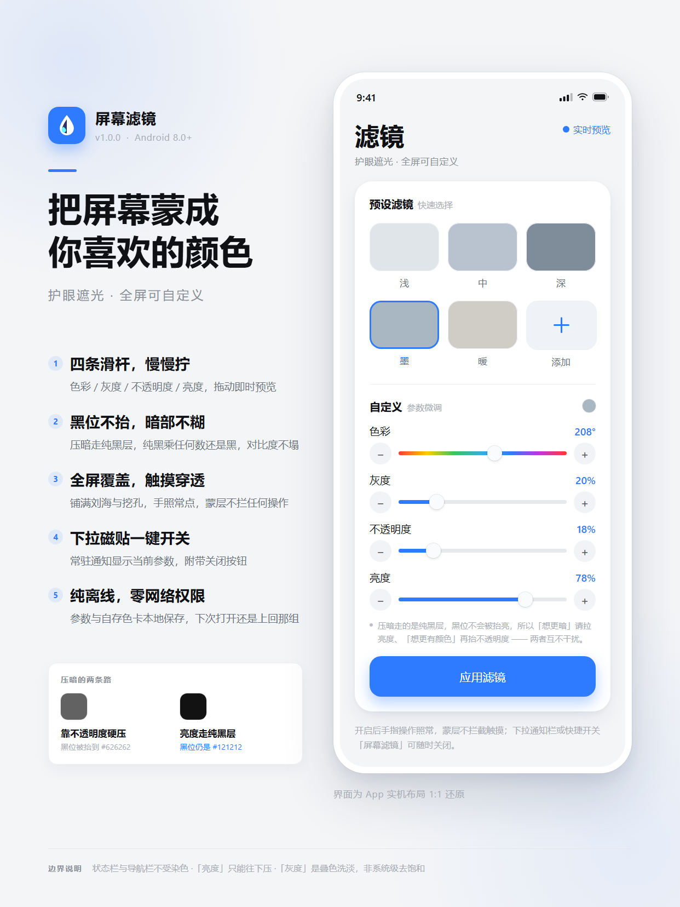

# 屏幕滤镜 Screen Filter

一个把整块手机屏幕「蒙」上自定义颜色的 Android App。
选好颜色、灰度、不透明度和亮度，点一下，滤镜就盖在所有 App 之上，手指操作照常穿透。

## 预览

## 功能

| 功能 | 说明 |
| --- | --- |
| 预设色卡 | 浅 / 中 / 深 / 墨 / 暖 五档，色卡直接预览「蒙上去之后屏幕大概什么颜色」 |
| 自定义 | 色彩（0–360°色相）、灰度（0–100%）、不透明度（0–100%）、亮度（0–100%）四条滑杆，带 −/+ 微调 |
| 自存预设 | 「＋」把当前参数存成色卡，长按自定义色卡可删除 |
| 实时预览 | 开关打开时拖动滑杆，屏幕上的蒙层立刻跟着变；关闭则需点「应用滤镜」才生效 |
| 全屏覆盖 | 铺满刘海与导航栏区域，触摸事件 100% 穿透，不挡任何操作 |
| 快捷开关 | 下拉通知栏里的「屏幕滤镜」磁贴，一键开 / 关 |
| 通知栏控制 | 常驻通知显示当前参数，附带「关闭」按钮 |
| 参数持久化 | 下次打开还是上次那组颜色 |

## 四个参数与两层叠加

滤镜是**两层**叠出来的：

```
   屏幕画面  →  [着色层]  →  [压暗层]  →  你看到的
                颜色 tint      纯黑
                透明度 t       透明度 d = 1 − 亮度
```

合成式：

```
out = (1 − d) · [ (1 − t) · content + t · color ]
```

- **色彩 + 灰度**算出着色层的颜色：`HSV(hue, 1 - gray/100, 1 - 0.5 * gray/100)`。
  灰度 0% 是最鲜艳的纯色相，100% 是完全不带色偏的中性灰。
- **不透明度 t** 是着色层叠上去有多重 —— **它也是黑位抬升的唯一来源**。
- **亮度**换算成压暗层的不透明度 `d = 1 − 亮度/100`，用一层纯黑给整幅画面乘系数。

### 为什么要拆成两层：黑不该变灰

单层彩色蒙层有个绕不开的数学性质。画面纯黑（`content = 0`）时：

```
out = (1 − t) · 0 + t · color = t · color
```

也就是说，只要蒙层带颜色，**黑位必然被抬到 `t × 颜色亮度`**——
比如 80% 不透明度的墨色，纯黑会被抬到亮度 ~104/255，明显发灰，
画面暗部的层次一起被压扁，对比度就塌了。这是参数调不掉的，只能换结构。

拆出压暗层之后：压暗层是纯黑，纯黑叠加等于给画面乘一个系数，
**黑乘任何数还是黑**，压暗一点都不伤对比度。于是：

- 想更暗 → 拉低**亮度**（动 `d`），黑位纹丝不动；
- 想更有颜色 → 抬**不透明度**（动 `t`），黑位才跟着抬。

两个旋钮互不干扰。默认档位（墨 · 灰度 20% · 不透明度 18% · 亮度 78%）下黑位抬升只有 ~18/255，
纯黑仍然是纯黑；而同样是墨色的旧单层模型（80% 不透明度）会把它抬到 ~98/255。

## 技术要点

- **全屏蒙层**：`WindowManager` 挂 `TYPE_APPLICATION_OVERLAY` 窗口 + `FLAG_NOT_TOUCHABLE`。
  这是第三方 App 免 root 能拿到的最高层级，盖在所有 App 之上，但仍在状态栏、输入法、锁屏这些系统关键窗口之下——**所以顶部状态栏那一小条不会被染色**，这类护眼 App 都是这个行为。
- **两层只用一个窗口**：窗口里放一个 `View`，背景是一个自绘 `Drawable`，`onDraw` 里连续两次
  `canvas.drawColor`（先着色层再压暗层）就画完了。比挂两个全屏窗口省掉一整块全屏 GPU layer 的开销。
- **常驻**：`specialUse` 类型的前台服务 + 低优先级常驻通知。
- **状态同步**：`FilterRepository` 里的 `StateFlow` 是 App 与悬浮窗之间唯一的状态源，参数一变蒙层立刻跟着变，不用 Intent 来回传。
- **快捷磁贴**：`TileService`，没权限时会自动把用户带回 App 授权。

## 权限

| 权限 | 用途 | 怎么给 |
| --- | --- | --- |
| 显示在其他应用上层 | 全屏蒙层的**必要前提** | App 内点黄色提示条跳系统设置，或 设置 → 应用 → 屏幕滤镜 → 显示在其他应用上层 |
| 通知 | 前台服务常驻通知 | 首次启动时弹窗申请 |
| 后台弹出 / 自启动（部分国产 ROM） | 避免蒙层被系统回收 | 手动在系统设置里放行 |

## 构建

环境：JDK 17+、Android SDK（platform 34、build-tools 34+）。Gradle 8.9 由 wrapper 提供。

```bash
./gradlew assembleDebug
# 产物：app/build/outputs/apk/debug/app-debug.apk
```

Debug 包的包名带 `.debug` 后缀（`com.shen.screenfilter.debug`），可以和正式包共存。

### 出正式签名包

正式包需要自己的 keystore —— **不能用 debug 证书**（换机器就换 key，已装用户无法覆盖升级）。

凭据放在工程根的 `keystore.properties`（已加进 `.gitignore`，**不进版本库**）：

```properties
STORE_FILE=C:/Users/shengqi/android-keys/screen-filter-release.keystore
STORE_PASSWORD=…
KEY_ALIAS=screenfilter
KEY_PASSWORD=…
```

同名环境变量优先级更高（方便 CI）。文件不存在时构建**不会失败**，只是降级产出未签名包并打一条警告。

```bash
./gradlew assembleRelease
# 产物：app/build/outputs/apk/release/app-release.apk
```

> ⚠️ **keystore 与 `keystore.properties` 必须备份**。它们不可再生 —— 丢了就永远无法给已安装的用户推送更新，只能换包名重发。

验证正式包是否达标：

```bash
aapt2 dump badging app-release.apk      # 包名不带 .debug、无 application-debuggable
java -jar $SDK/build-tools/36.0.0/lib/apksigner.jar verify --print-certs app-release.apk
```

## 宣传物料

`poster/xiaohongshu-1242x1656.html` 是小红书竖版海报的源文件（单文件 HTML/CSS，无外部依赖）。改文案直接编辑它，然后重新出图：

```bash
msedge --headless=new --disable-gpu --hide-scrollbars \
  --force-device-scale-factor=1 --window-size=1242,1656 \
  --screenshot=poster/xiaohongshu-1242x1656.png \
  poster/xiaohongshu-1242x1656.html
```

海报里的手机界面是用 CSS 按 App 真实布局和真实色值画的 —— 改了参数或预设，海报要跟着改，别让海报和 App 对不上。


## 目录结构

```
app/src/main/java/com/shen/screenfilter/
├── ScreenFilterApp.kt              应用入口，初始化仓库
├── MainActivity.kt                 单 Activity，处理悬浮窗 / 通知权限
├── data/
│   ├── FilterConfig.kt             四个参数 → 两层叠加的 ARGB（含黑位抬升估算）
│   ├── FilterPreset.kt             预设色卡定义
│   └── FilterRepository.kt         StateFlow 状态源 + SharedPreferences 持久化
├── overlay/
│   ├── FilterOverlayService.kt     前台服务 + 全屏悬浮窗（单窗口两层自绘）
│   └── FilterTileService.kt        下拉快捷磁贴
└── ui/
    ├── FilterScreen.kt             主界面（预设网格 / 滑杆 / 应用按钮）
    ├── components/ThinSlider.kt    自绘滑杆（支持彩虹色相轨）
    ├── theme/Theme.kt
    └── vm/FilterViewModel.kt       draft / applied 两套状态
```

## 已知边界

- 状态栏、导航栏区域**不会**被染色（系统关键窗口的层级高于 `TYPE_APPLICATION_OVERLAY`，需要签名权限才能覆盖）。这是免 root 方案的天花板。
- 「灰度」是**叠一层中性色把画面洗淡**，不是对下层画面做真正的去饱和处理 —— 悬浮窗只能叠加，看不到也改不了下层画面。真·全屏灰度得走系统显示管线（`accessibility_display_daltonizer` 或 SurfaceFlinger 层变换），需要 `WRITE_SECURE_SETTINGS` / root，本工程没有引入。
- 「亮度」只能**往下压**，不能往上提。蒙层是叠加不是相乘提亮，想提亮得走系统亮度通道。
- 从最近任务里划掉 App 时，滤镜**继续保留**（这是设计选择：选一次就让它一直在）；
  要关掉用通知栏的「关闭」或下拉磁贴。
